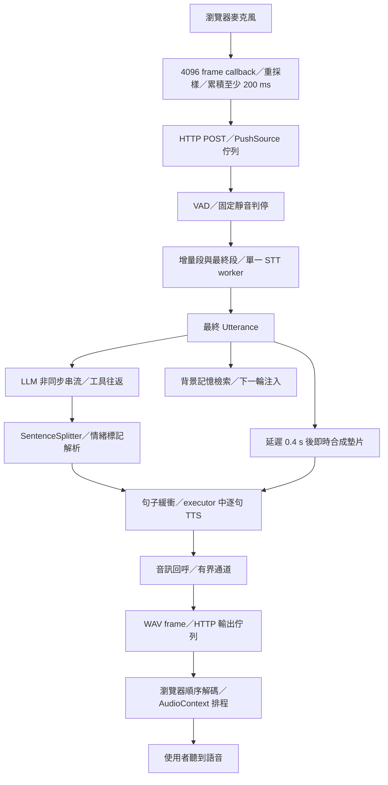

# 端到端語音流程審視：延遲、連續播放與自然度

日期：2026-09-26。研究基準：Echo-Stream `7b415cd` 加本機未提交修改。

## 結論

優先補上播放生命週期與推理工作管理，再依完整時間線定位剩餘延遲。現有程式已做 LLM／TTS 重疊、增量 STT、順序解碼與連續排程，無須重建這些能力。目前最重要的缺口是：

1. Web 將音訊送出視為播完，回合過早結束，插話與歷史記帳無法對齊實際播放。
2. 墊片取消未終止底層同步工作，同一個 TTS 後端可以同時進入兩次合成；已用無模型假後端重現。
3. 背壓只存在於部分通道，Web 輸出佇列滿時靜默丟 frame，沒有依播放秒數控制領先量。
4. 輸入分包、判停、轉錄排隊與網路時間沒有完整拆開；現有 TTFA 不是使用者端首音延遲。
5. 語調斷裂與播放斷流必須各自量測。獨立合成的上下文、情緒與韻律延續，是自然度研究的核心。

本輪新增研究文件與離線診斷腳本，未修改管線、啟動服務或載入推理模型。既有問題的修正涉及播放協定與共享模型生命週期，應按下方工項分開實作，避免直接混入本機尚未提交的功能修改。

## 範圍與證據等級

- 目前以 Web 的語音輸入到瀏覽器播放為實際路徑。Discord 尚無實測，不能宣稱已驗證。
- 本機 TTS 已使用 IndexTTS 2.5 模型；不另列「升級 2.5」實驗。
- 主要新技術參考為 IndexTTS 2.5、Breeze TTS 2、AuK／AuK-Flash。其他模型保留為設計參考。
- **程式確認**：可由當前呼叫路徑直接證明的行為。
- **離線重現**：無 GPU 假後端可重現的生命週期問題，不代表真 GPU 的速度或音質。
- **歷史觀察**：2026-08-23～24 的本機 trace，不代表目前效能。
- **待驗證推論**：GPU 競爭的毫秒成本、真正斷流的來源、情緒對咬字的因果效果。

## 實際資料流



注意：墊片實際另呼叫相同 SpeakStage 的 stream，不是與正式句子共用同一條序列佇列。圖中的匯合代表共用模型資源。

## 優先發現

### P0：Web 播放生命週期與回合生命週期脫節

位置：`echo_stream/web/server.py:1329`、`echo_stream/core/pipeline.py:193`、`echo_stream/core/pipeline.py:206`、`echo_stream/web/static/index.html:561`。

`_EmitSink.drain()` 直接返回；`played_duration_s` 回傳 written duration。PipelineRunner 因此在音訊送完後清掉 current token、commit 歷史；前端收到 META 就停用停止按鈕並切回 idle，沒有等待 AudioContext 中已排程的尾段播完。

自動插話的 server guard 是 `runner.is_speaking`，實際只看 current token。生成已結束但音訊仍在播時，這個 guard 已為 false。新輸入最後成為 UTTER 才會在前端 stopAudio，無法保證使用者開口後立即停掉尾段。這是程式路徑確認；未操作真瀏覽器重現。

**修正方向**：前端回報 turn／generation／chunk 的播放進度與完成／中止；後端依回報管理 drain、spoken_text 與插話生命週期。斷線須有逾時與終止處理；不要用「睡完整音訊長度」替代播放回報。

**驗收**：假設 10 秒音訊在 2 秒生成完，於第 5 秒插話，仍須停播、保留停止控制，且歷史只記已播內容。斷線及舊 generation 回報不得卡住下一輪或覆寫新輪進度。

### P0：取消墊片後同步推理仍活著，同一模型可重入

位置：`echo_stream/core/gap_filler.py:149`、`:176`；`echo_stream/web/server.py:398`；`echo_stream/adapters/speak_indextts.py` 的 `stream`、`_produce`、`_apply_style`。

GapFiller 使用新的、未連結父回合的 CancellationToken；stop 取消 asyncio task，未取消該 token。executor 的同步 generate 不會因此退出。正式回答使用同一個 `_speak`，兩條 stream 各自建立 producer；沒有跨 stream 的模型所有權保護。`_apply_style` 修改同一個 backend 的情緒／語速，程式的「句子序列合成」假設只在單條 stream 內成立。

離線腳本結果：

```json
{"active_after_gap_stop": 1, "maximum_simultaneous_generate": 2}
```

這證明工作仍在執行與重入，沒有證明 CUDA 錯誤或歷史延遲由此造成。既有 `tests/test_gap_filler.py:123` 使用可取消的 fake async stage，無法涵蓋阻塞 executor 的邊界。

**修正方向**：為每個合成工作持有可取消 token；取消向 callback 傳遞；確保上一工作真正退出後才能重用模型狀態。正式回答優先，過期墊片不得再排入推理。不能只加 async lock 後取消 future 就提早釋放鎖，也不能在模型 callback 所需的事件迴圈上使用阻塞鎖。

尊重既有決策：不自行恢復預建語音庫、不打斷已排入播放的墊片。STT 與 TTS 的 GPU 資源競爭另行量測，避免一把全域鎖把 STT 也堵住。

**驗收**：threading.Event 固定交錯；取消後 token 生效、producer 可退出；模型 maximum active=1；下一輪不受上一輪風格污染；多 chunk 且佇列滿時不留下阻塞執行緒。

### P1：Web 的佇列邊界會丟音訊，無法保證播放端背壓

位置：`echo_stream/web/server.py:991`、`:1072`、`:1345`；`echo_stream/core/channel.py` 的 `put_threadsafe`。

語音 session 的 out queue 上限是 256 個 frame，emit 對 QueueFull 直接 suppress。網路消費者慢時，音訊／狀態 frame 都可能無告警地丟掉。`_EmitSink.write` 很快返回，內部 TTS 的有界通道不能反映瀏覽器究竟還積了幾秒音訊。

這是可達的滿佇列行為，尚未證明歷史 session 曾達 256。不要把所有卡頓都歸因於它。

**修正方向**：依音訊秒數建立高低水位；音訊 frame 不可靜默丟棄；控制／取消訊號保留通道；傳輸中攜帶順序與 generation。避免縮小 chunk 後反而更快耗盡以 frame 數計算的佇列。

**驗收**：刻意降低接收速度並插話，檢查序號連續、緩衝上界、停止訊號送達及不再合成過期段。

### P1：首音量測與輸入時鐘都缺少前端界線

位置：`echo_stream/core/tracer.py:86`；`echo_stream/core/pipeline.py:174`；`echo_stream/adapters/input_stt.py:365`；`echo_stream/web/static/index.html:352`、`:714`。

目前 speak_first_chunk 在 gap.stop 之後、sink.write 之前；tts_first_chunk 不是純模型時間。speech_end 從 server 收到音訊後的時鐘回推，缺少 capture timestamp，無法完整還原網路前的實際說完時刻。stt 欄位包含判停與排隊，不能等同 Whisper 推理。

4096 frame callback 在 48 kHz 約 85 ms；累積至少 200 ms 才送，可能跨到約 256 ms 才發送，實際依裝置 sample rate 決定。每次 POST 沒有音訊序號與明確排序協定，HTTP thread 按到達順序 push；存在亂序／靜默上傳失敗風險，尚未證明曾發生。

**修正方向**：先加入前端 capture／receive／decode／schedule／playback 的同時鐘事件，再比較較小分包或 AudioWorklet／持久傳輸。跨機器時鐘不可直接相減；以音訊 sample offset 加 ping 對時與誤差範圍連接時間線。排程起點只是裝置輸出的近似值，精確物理首音需 loopback。

## 已有能力與尚待定位之處

- **STT**：目前是單 worker 增量轉錄，partial 在至少 2 秒待轉錄音訊與 0.35 秒停頓後切出；final 等前面已排入的 partial。優先量佇列等待與殘餘轉錄，勿再提議從零新增增量 STT。Web 建構未注入語意判停器，adapter 預設仍是 SilenceTurnDetector；文件提到 Smart Turn 不等於此入口已啟用。
- **LLM**：SessionControl `echo_thought_core/backends/openai.py:379`、`:446` 使用 async client 串流；不是在這裡等待完整回答。需要細分建立請求／首事件／首文字／工具開始與結束／第二次請求。慢首 token 不足以判定純網路慢，也可能包括工具決策或本機工作。
- **Memory**：自動 retrieve 與 LLM 並行，結果下一輪注入（`think_llm.py:496`）；當輪 deep_recall 才是工具往返。memory adapter 使用專用單執行緒，保留其存取安全性；調整讀寫優先順序前要先量排隊。不要改回等待記憶才出首句，或假設能修改正在生成請求的前綴。
- **歷史**：目前 `_build_messages` 取最後 20 則訊息；不是完整 ContextManager 壓縮工作流。未確認 token 數、provider cache 命中與長對話成本前，不把效能改善歸功於壓縮／快取。
- **TTS**：本機 lite_engine 已有暖機、GPT cache／compile 及平台特定 S2Mel guard。已有 `experiments/v25_compile_s2mel_probe.py` 等實驗；先核對結果再動。不能單憑預設參數宣稱執行時已啟用加速，也不移除 sm_120 防護。
- **切分**：目前 first 6／14、後續 28／64，仍是固定文字權重，不知道播放 buffer 還剩幾秒。候選方向是以合成耗時估計與播放剩餘量選自然切點；先確認空白來自供應不足，再調節。
- **輸出**：目前有順序 decode 與 AudioContext 排程，避免回到 onended 才送下一段。WAV frame → decodeAudioData 的成本應先量；小 chunk 後可評估 PCM ring buffer，但它不會修正模型生成的句末語調。

## 舊 trace：用途與限制

檔案位於 `outputs/web_logs/`，診斷腳本只讀數值，不複製對話內容。共 5 份 trace、41 輪、24 輪 phase=done。以下每份 session 分開計算：

| 檔名後綴 | 全部／完成 | 已完成回合後端 TTFA 中位數 | 範圍 |
| --- | ---: | ---: | ---: |
| 20260823_142412 | 4／3 | 12.905 s | 5.221–18.138 s |
| 20260824_155544 | 4／1 | 6.821 s | 單筆 |
| 20260824_162143 | 21／10 | 6.580 s | 5.168–23.455 s |
| 20260824_171058 | 6／6 | 6.817 s | 4.769–9.219 s |
| 20260824_212204 | 6／4 | 7.018 s | 5.656–16.765 s |

部分 STT 欄位只有約 1 ms，可能是文字輸入；本表未依 origin 篩選，不能稱作純語音實驗。歷史設定不同、樣本少，且排除取消會有存活偏差，不合併做效能承諾或 p95。phase=done 也只代表後端完成。

舊 trace 無逐 chunk 到達與實際播放時間，無法算斷流次數／長度。這正是需要補的觀測缺口，不能靠首音數字代替。

## 新技術如何對應需求

### Breeze TTS 2：執行期加速與表達方式

[官方程式](https://github.com/breezeblue-ai/breeze-tts) 公開分階段快路徑：依長度與 CFG 形狀選 CUDA Graph、StaticCache decode、depth decoder 編譯、逐 frame codec 解碼。可借鑑長壽命模型、固定 cache、shape bucket、逐階段驗證的方法；其模型內部 tensor／cache 不能直接移植到 IndexTTS。

Voice Direction 與 inline vocal events 適合參考上層表達契約。Index adapter 現在會剝括號；若接事件，須先解析成結構化資料，不能直接沿用 sanitize，否則可能把事件名稱念出來。維持跨 chunk 的同一說話風格與意圖，再決定停頓、重音及呼吸；避免額外 LLM 請求落在首音關鍵路徑。

官方的 <40 ms 是 H100 暖機快路徑；不能推成本機數字。公開 API 接收 text、輸出 PCM 串流，不足以證明可對同一請求持續追加 LLM 文字。[API 原始碼](https://github.com/breezeblue-ai/breeze-tts/blob/main/breeze_infer/api.py)

### AuK／AuK-Flash：少步數蒸餾與統一表達

[技術報告](https://arxiv.org/abs/2609.08936) 的 Flash 透過蒸餾達成四步、免 CFG 推理，報告相對完整模型約 4.5 倍加速。這是模型訓練成果，不能用修改 IndexTTS 採樣步數替代。

[模型卡](https://huggingface.co/tencent/AuK-Flash/blob/main/README.md) 包含情緒、速度、非語言事件等生成／編輯能力，也列出額外的 Qwen2.5-Omni-3B encoder 依賴；部署成本不能只計 1.5B 主模型。生成速度、串流首音與後製完成時間需分開，沒有驗證首音與中文角色品質前，不將後製放進即時回答路徑。

### IndexTTS 2.5：既有資產與可移植範圍

先保留目前聲線與八維控制，將本機已做的 compile／sampling／CFM／LoRA 結論整理成對照表。Faster IndexTTS-2 的 [TensorRT 後端](https://github.com/index-tts/index-tts/blob/main/backends/trt/README.md) 是參考來源，2 與 2.5 的 checkpoint、語言 embedding、LoRA、emotion conditioning 相容性需逐項核對；端到端倍率不能直接除在目前首音上。

## 自然度驗收

將同一批既有語料與音訊用於以下分類，避免重新做全模型排行榜：

1. **斷流**：下一 chunk 到達晚於前一 chunk 排程結束，記錄空白次數與總毫秒。
2. **生成的停頓**：音訊本身帶靜音；與 buffer starvation 分開。
3. **韻律斷裂**：語調／重音／語速在切點重置，淡入淡出無法解決。
4. **角色與情緒**：聲線相似、風格延續、標記轉折是否自然；保留中文、英文混合及極短句。
5. **互動**：插話停播延遲、回應接續、是否重複使用者尚未聽到的內容。

理想方向是將「語意／韻律單位」與「傳輸音訊小塊」分離。保持較完整的合成上下文，同時提早輸出小音訊塊；若模型不支援跨塊狀態，就明確標為模型能力缺口，不用更多硬切模擬。

## 實作順序與最小驗證

| 順序 | 工作 | 正向驗收證據 |
| --- | --- | --- |
| 1 | 播放回報、generation、斷線終止與端到端 trace | 播放尾段仍可插話；送出、排程、播出三者可區分 |
| 2 | TTS 工作所有權與墊片取消 | 假後端最大 active=1；滿佇列取消可退出；不污染下一輪 |
| 3 | 輸入序號、傳輸水位、輸出不靜默丟 frame | 慢接收與亂序注入下有可觀測結果；取消不被佇列堵住 |
| 4 | 依時間線選一個最大等待來源處理 | 相同舊語料／相同文字到達時序，對應分段延遲下降 |
| 5 | 韻律連續性與推理加速局部原型 | 首音、斷流、角色音質三者一起比較，不只總 RTF |
| 6 | Discord adapter | 另驗證收送格式、播放時鐘、停止與多人辨識，不沿用 Web 驗收結果 |

前端事件需有 session、turn、generation、chunk index；GPU 工作需有 queued／started／first callback／finished／cancel requested。記錄上下文 token 數與實際加速設定，避免只記模型版本。初期以既有 session 重播與假後端補契約證據；GPU、LLM、實機聽感測試另在明確安排後執行。

## 本輪驗證

離線診斷：`scripts/audit_voice_latency.py`。只使用標準庫、目前 adapter 與注入的阻塞假後端；跳過 prepare，因此不清理既有暫存資料、不載入模型、不產音訊。自建暫存目錄於結束清理。

```powershell
$env:PYTHONIOENCODING='utf-8'
& '../U.E.P-s-Core/env/Scripts/python.exe' -B scripts/audit_voice_latency.py
& '../U.E.P-s-Core/env/Scripts/python.exe' -B -m ruff check scripts/audit_voice_latency.py
```

初次審視時兩者通過，當時尚未修改既有六個 dirty 檔案。後續依使用者指示，兩個 gpt-6-luna 子代理接手 TTS 取消／所有權與 Web 播放回報；修正疊加在既有工作區變更上，沒有還原或覆蓋原本的即時墊片設計。

修後再次執行同一診斷：`active_after_gap_stop=1`，`maximum_simultaneous_generate=1`；釋放阻塞前只進入墊片，釋放後正式回答才進入模型。這證明停止等待後仍保留模型所有權，不代表 GPU 可以立即停止段內運算，也不代表已量出真實 TTFA 改善。

另修正 `PipelineRunner._drain_or_cancel` 吞掉播放例外的問題，讓播放確認失敗回報 FAILED、完成與取消同時發生時以取消為準，並等待播放 task 清理。扣除墊片時，回答已播量最低為零，避免墊片尚未播完就插話產生負數。

未跑全套 Web tests（其中會啟動 HTTP server），未將假後端測試當成實際聽感或 Discord 驗收，沒有 commit。後續優化選擇與最小比較設計見同日《優化方向與技術移植》。

### 優先修正的驗證範圍

- TTS／墊片：40 個測試通過，包含同步 worker 所有權、滿佇列取消與風格隔離。
- 核心管線／channel／取消／tracer：54 個測試通過，包含播放例外與取消競態。
- Web 播放契約／管線整合：8 個不開 listener 的測試通過。生成結束後仍可插話、ACK 前不提交歷史、完成 ACK 才回報 DONE、先到的停止 ACK 保留取消語意。
- 前端以 Node VM 與假 AudioContext 驗證解碼中取消、generation 失效與取消後重新計算排程尾端；仍需真實瀏覽器與音效裝置驗收。

Web frame 新增 generation、chunk index、時長及 begin／end／abort 控制；後端的 `played_seconds` 使用瀏覽器回報。這是播放時鐘的估計，受回報頻率與音效裝置延遲影響；`spoken_text` 仍按既有句子／chunk 規則推估，沒有字級音訊對齊。原本 tracer 的 TTFA 尚未改成瀏覽器實際首音，完整跨端時間線仍是後續工作。

`use_accel` 已接到建構參數與 `ECHO_STREAM_TTS_USE_ACCEL`，預設關閉；實際加速後端、fallback 與 GPU 共用情境尚未量測。輸入 HTTP 分塊的序號／排序、播放水位切句與自然度比較尚未實作。前後端音訊 frame 格式需一起更新，舊測試 client 已調整，HTTP 整合測試本輪未執行。
